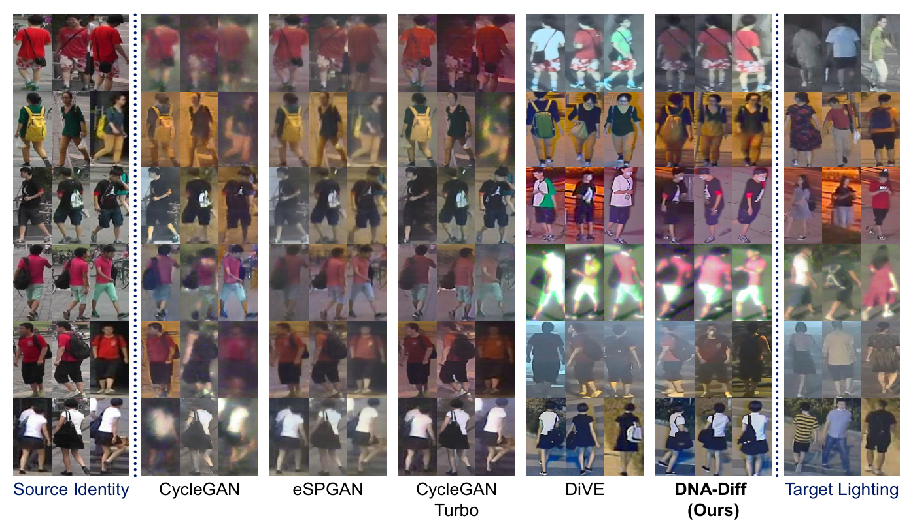
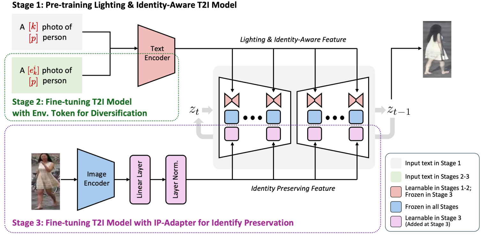

<div align="center">

# DNA-Diff: Day-to-Night Adaptation via Diffusion

### Lighting-Aware Diffusion-based Data Augmentation for<br>Robust Low-Light Re-Identification

**Accepted at BMVC 2026** · Official implementation

Toan Manh Bui · Donghyeok Min · Inyoung Oh · Junghyun Cho

[](https://manhtoanbui01.github.io/dna-diff-page/)
[](TBA)
[](https://huggingface.co/manhtoanbui01/DNA-Diff)
[](environment.yml)
[](environment.yml)
[](environment.yml)

</div>

DNA-Diff turns labelled
daytime ReID data into realistic nighttime training images. It uses
environment tokens for lighting diversity and an IP-Adapter for identity
preservation, and it needs no paired day/night data.

<p align="center">
  <br>
  <em>Market-1501 identities rendered under NightReID lighting.</em>
</p>

DNA-Diff fine-tunes Stable Diffusion v1.5 in three stages so that it can render a
given identity, taken from a daytime reference image, under a specific night-time
camera and a specific lighting condition:

<p align="center">
  <br>
  <em>Overview of the DNA-Diff architecture.</em>
</p>

| Stage | Script                                   | What it learns                                                                                                                                  |
| ----- | ---------------------------------------- | ----------------------------------------------------------------------------------------------------------------------------------------------- |
| 1     | `Data_Generation/train_t2i_ila.py`       | **ILA** (Identity- and Lighting-Aware) base stage: LoRA on the UNet plus a textual-inversion token per identity and per camera.                 |
| 2     | `Data_Generation/train_t2i_envtoken.py`  | **Environment tokens** — one learned token per lighting group per camera, initialised from the stage-1 weights.                                 |
| 3     | `Data_Generation/train_t2i_ipadapter.py` | **IP-Adapter** conditioning on OSNet identity features, so appearance is carried over from a reference image instead of only from a text token. |

Inference (`Data_Generation/generate_t2i.py`) then takes daytime Market-1501
crops as identity references and generates night-time images for every
camera / environment combination.

Each stage is named after what it adds, and the checkpoint directory it writes
follows the same convention: `finetune_stage1_ila/`, `finetune_stage2_envtoken/`,
`finetune_stage3_ipadapter/`

---

## Contents

<div align="center">
  <a href="#1-repository-layout"><b>1 · Repository layout</b></a> &nbsp;·&nbsp;
  <a href="#2-requirements"><b>2 · Requirements</b></a> &nbsp;·&nbsp;
  <a href="#3-installation"><b>3 · Installation</b></a> &nbsp;·&nbsp;
  <a href="#4-data-preparation"><b>4 · Data preparation</b></a> &nbsp;·&nbsp;
  <a href="#5-training"><b>5 · Training</b></a>
  <br>
  <a href="#6-generation"><b>6 · Generation</b></a> &nbsp;·&nbsp;
  <a href="#7-exporting-synthetic-data-for-reid-training"><b>7 · Export for ReID</b></a> &nbsp;·&nbsp;
  <a href="#8-paths-to-change-when-porting-to-a-new-machine"><b>8 · Porting</b></a> &nbsp;·&nbsp;
  <a href="#9-troubleshooting"><b>9 · Troubleshooting</b></a>
  <br><br>
  <sub><b>In a hurry?</b> Skip training —
  <a href="#55-using-published-pretrained-weights-skip-training">§5.5</a>
  runs generation straight from the released weights.</sub>
</div>

---

## 1. Repository layout

```
DNA-Diff/
├── environment.yml                 # conda environment (primary install path)
├── figures/                        # figures used by this README
├── Preprocess/
│   ├── group_by_lighting.py        # split NightReID by brightness into env groups
│   ├── market2nightreid.py         # append Market-1501 as the daytime camera
│   └── c2hf.py                     # convert the folder tree to a HF arrow dataset
├── Data_Generation/
│   ├── train_t2i_ila.py            # stage 1
│   ├── train_t2i_envtoken.py       # stage 2
│   ├── train_t2i_ipadapter.py      # stage 3
│   ├── train_common.py             # helpers shared by the three stages
│   ├── lora_ipadapter.py           # IP-Adapter attention processors / projection
│   ├── generate_t2i.py             # inference
│   ├── semantic_aug/               # dataset + augmentation/pipeline wrappers
│   ├── deep_person_reid/           # vendored torchreid (OSNet) — not in git
│   └── scripts/
│       ├── finetune_step1.sh  finetune_step2.sh  finetune_step3.sh
│       ├── finetune_all.sh         # runs all three stages sequentially
│       └── sample.sh               # inference wrapper
├── move_synthetic_market1501.py    # export generated images to Market-1501 naming
└── dataset/                        # data + checkpoints — not in git
```

Everything under `dataset/`, `Data_Generation/deep_person_reid/`,
`Data_Generation/finetune_model/`, `Data_Generation/outputs/` and
`stable-diffusion-v1-5/` is git-ignored and must be obtained/produced locally.

---

## 2. Requirements

- Linux x86_64
- NVIDIA GPU(s) — training was done on **3** GPUs with `batch_size=32` each GPU,
  LoRA `rank=128`, fp16
- NVIDIA driver supporting CUDA 12.1 or newer (the CUDA runtime ships with the
  PyTorch wheels; no system CUDA toolkit is required)
- conda / mamba
- ~80 GB free disk for the dataset, checkpoints and generated images

---

## 3. Installation

### 3.1 Clone the repository

```
git clone https://github.com/manhtoanbui01/DNA-Diff.git DNA-Diff
cd DNA-Diff
```

### 3.2 Create the environment

```
conda env create -f environment.yml
conda activate dna-diff
```

> [!IMPORTANT]
>
> `diffusers` is pinned to **0.23.1**. The training scripts subclass the LoRA
> attention processors from that release; later versions relocate them and the
> import will fail.

<!-- Configure `accelerate` once (choose multi-GPU, fp16):

```
accelerate config
``` -->

### 3.3 Download Stable Diffusion v1.5

```
pip install huggingface_hub
```

Log in to Hugging Face:

```
huggingface-cli login
```

Go to <https://huggingface.co/settings/tokens>, generate a new personal access
token, and use it when prompted by `huggingface-cli login`.

Download the model:

```
huggingface-cli download stable-diffusion-v1-5/stable-diffusion-v1-5 --local-dir ./stable-diffusion-v1-5
```

> [!TIP]
>
> **Attention:** add `--local-dir-use-symlinks False` to download directly to
> the given path.

The scripts run with `--local_files_only`, so the model must be on disk. Note
its path — it is passed as `model_path` to every script below.

Change directory to:

```
cd Data_Generation
```

### 3.4 Provide the OSNet ReID backbone

The commands in this section run from `Data_Generation/`, where §3.3 left you.

Stage 3 and inference extract identity features with OSNet from a **vendored,
locally modified** copy of
[`deep-person-reid`](https://github.com/KaiyangZhou/deep-person-reid) that lives
at `Data_Generation/deep_person_reid/`.

> [!WARNING]
>
> **Do not replace it with a fresh upstream clone.** Some of its modules have
> been rewritten to import through the `deep_person_reid.` prefix
> (`torchreid/utils/feature_extractor.py`), while the rest still use bare
> `torchreid` imports. Upstream has neither mix, so a clean clone will not work
> as a drop-in. The directory is currently listed in `.gitignore`, so it is not
> carried by the repository — if you are setting this up on a new machine, copy
> `Data_Generation/deep_person_reid/` across from an existing checkout.

If you have no copy to hand and must clone it, **clone into a folder named with
underscores** — the code does `from deep_person_reid.torchreid.utils import ...`,
and a plain `git clone` would create `deep-person-reid`, which is not a valid
Python package name:

```
git clone https://github.com/KaiyangZhou/deep-person-reid.git deep_person_reid
```

Place the **`osnet_ain_x1_0`** multi-source checkpoint (`MS+D+M->C`, from the
[torchreid model zoo](https://kaiyangzhou.github.io/deep-person-reid/MODEL_ZOO.html))
at exactly:

```
deep_person_reid/osnet_ain_ms_d_m.pth.tar
```

**No installation step is required.** `generate_t2i.py` and
`train_t2i_ipadapter.py` add `Data_Generation/` and
`Data_Generation/deep_person_reid/` to `sys.path` themselves, resolved relative
to the script, so the vendored copy is picked up without `pip install`.

Do **not** `pip install torchreid` from PyPI. That is an unrelated third-party
repackaging (version 0.2.5, with a different `torchreid/reid/...` layout). It
happens to satisfy the vendored package's bare `torchreid` imports, which masks
a misconfigured path and silently mixes two different copies of the library.

The OSNet checkpoint path above is **relative to the working directory**, so all
training and generation commands must still be run from inside
`Data_Generation/`.

---

## 4. Data preparation

### 4.1 Download the source datasets

- **NightReID** — the night-time ReID training split (`bounding_box_train`),
  filenames of the form `0042R3_*.jpg` (`L1..L3`, `R1..R3` = 6 cameras).
  <https://github.com/msm8976/NightReID>
- **Market-1501** (`Market-1501-v15.09.15`) — used as the daytime reference
  camera; the `gt_bbox` folder is the one that is read.
  <https://zheng-lab-anu.github.io/Project/project_reid.html>

### 4.2 Split the night-time cameras into lighting groups

`Preprocess/group_by_lighting.py` sorts each camera's crops by mean HSV
_value_ and splits them into `NUM_GROUPS` (default **10**) equally sized
environment groups.

This script is configured by **constants at the top of the file**, not by CLI
flags — edit them first:

```python
INPUT_PATH  = "/path/to/NightReID/bounding_box_train/"
OUTPUT_PATH = "/path/to/DNA-Diff/dataset/NightReID_Market1501"
NUM_GROUPS  = 10
```

```
python Preprocess/group_by_lighting.py
```

It **wipes and recreates** `OUTPUT_PATH`, then writes:

```
dataset/NightReID_Market1501/
├── cam1/env1 … env10/   <id:04d>/*.jpg   # env = (cam-1)*10 + level, 1 = darkest
├── cam2/env11 … env20/  …
├── …
├── cam6/env51 … env60/  …
└── exp/train_id.txt                       # comma-separated relabelled identities
```

### 4.3 Append Market-1501 as the daytime camera

```
python Preprocess/market2nightreid.py \
    --market_gt_bbox_dir  /path/to/Market-1501-v15.09.15/gt_bbox \
    --nightreid_dir       dataset/NightReID_Market1501/ \
    --max_nightreid_id    500 \
    --num_cameras_nightreid 6 \
    --num_env_tokens_per_camera 10 \
    --min_images_per_id   2
```

Market identities with at least `--min_images_per_id` images are copied to
`cam7/env61/` and relabelled starting at `max_nightreid_id + 1` (so `0501`,
`0502`, …); `exp/train_id.txt` is appended in place.

> [!IMPORTANT]
>
> `--max_nightreid_id` must match the highest identity produced in 4.2,
> otherwise identities collide. The same value is reused at generation time as
> `--threshold`, which tells the sampler which identities are the daytime ones.

### 4.4 Convert to a HuggingFace dataset

```
python Preprocess/c2hf.py \
    --dataset     NightReID_Market1501 \
    --base_path   dataset/NightReID_Market1501 \
    --num_cameras 7
```

This writes the arrow dataset **into `--base_path`** (`data-*.arrow`,
`dataset_info.json`, `state.json`) and a
`camera_environment_description_mappings_NightReID_Market1501.json` file into
the current directory, mapping each camera to a random 4-character
pseudo-word used as its text description.

Only crops with `height >= 2 * width` are kept, and identities that appear in
only one camera are dropped (there would be no cross-camera reference image).

The resulting tree is what all later steps point at:

```
dataset/NightReID_Market1501/
├── cam1 … cam6/env*/      # night-time, 10 environments each
├── cam7/env61/            # daytime (Market-1501) reference images
├── exp/train_id.txt
├── data-0000*-of-*.arrow, dataset_info.json, state.json
└── finetune_model/        # created by training
```

---

## 5. Training

All three stages read the dataset through the `HUG_LOCAL_IMAGE_TRAIN_DIR`
environment variable, which the shell wrappers set for you. Run everything from
`Data_Generation/`.

### 5.1 Run the whole pipeline

```
cd Data_Generation
GPU_IDS="0,1,2" bash scripts/finetune_all.sh \
    ../dataset/NightReID_Market1501/ \
    ../stable-diffusion-v1-5
```

Positional arguments: `steps`, `batchsize`, `nepoch`, `rank`, `gpu_ids`
(defaults: `"1 2 3"`, `32`, `100`, `128`, `1,2,3`).

Useful environment variables:

| Variable                               | Default                          | Meaning                                           |
| -------------------------------------- | -------------------------------- | ------------------------------------------------- |
| `STEPS`                                | `"1 2 3"`                        | which stages to run, e.g. `"2 3"`                 |
| `GPU_IDS`                              | `1,2,3`                          | physical GPU ids passed to `accelerate --gpu_ids` |
| `LOG_DIR`                              | `<data_dir>/finetune_model/logs` | per-stage logs                                    |
| `STEP1_MAX_STEPS` / `STEP1_CKPT_STEPS` | `100000` / `25000`               | stage-1 schedule                                  |
| `STEP2_MAX_STEPS` / `STEP2_CKPT_STEPS` | `40000` / `10000`                | stage-2 schedule                                  |
| `STEP3_MAX_STEPS` / `STEP3_CKPT_STEPS` | `30000` / `10000`                | stage-3 schedule                                  |

Do **not** also set `CUDA_VISIBLE_DEVICES` — `GPU_IDS` is already physical
indices and setting both remaps them twice.

The wrapper verifies that each stage produced the artefacts the next stage
needs, and logs to `<data_dir>/finetune_model/logs/stepN_<timestamp>.log`.

### 5.2 Run a single stage

Use the same `finetune_all.sh`, just narrowing `steps` — either as the `STEPS`
environment variable or as the third positional argument:

```
cd Data_Generation

STEPS="1"   bash scripts/finetune_all.sh      # stage 1 only
STEPS="2"   bash scripts/finetune_all.sh      # stage 2 only
STEPS="2 3" bash scripts/finetune_all.sh      # stages 2 and 3

bash scripts/finetune_all.sh "" "" "2"        # same thing, 3rd positional
```

Every other argument and environment variable from §5.1 still applies, so
`GPU_IDS="0,1,2" STEPS="2" bash scripts/finetune_all.sh` works as expected.

Stages 2 and 3 are not standalone — they load the previous stage's weights.
`finetune_all.sh` checks for them first and stops with
_"Run step 1 first, or add it to STEPS"_ rather than failing part-way into
training, so a missing prerequisite costs you seconds, not hours.

> [!NOTE]
>
> **Re-running a finished stage resumes, it does not restart.** > `--resume_from_checkpoint` defaults to `"latest"`, so the script finds the
> existing checkpoint, loads it, and exits almost immediately because
> `global_step` already equals `max_train_steps`. To genuinely retrain a stage,
> move its output directory aside first, or point `output_dir` somewhere new.

### 5.3 Outputs

```
dataset/NightReID_Market1501/finetune_model/
├── finetune_stage1_ila/
│   ├── checkpoint-100000/model.safetensors
│   └── learned_embeds-steps-100000.bin
├── finetune_stage2_envtoken/
│   ├── checkpoint-40000/model.safetensors
│   └── learned_embeds-steps-40000.bin
└── finetune_stage3_ipadapter/
    └── checkpoint-30000/…
```

### 5.4 ⚠️ Cross-stage checkpoint paths are hard-coded

Each stage loads the previous stage's weights from paths that embed the
previous stage's **step count**:

| File                                              | Line          | Expects                                                                                                                                                                         |
| ------------------------------------------------- | ------------- | ------------------------------------------------------------------------------------------------------------------------------------------------------------------------------- |
| `train_t2i_envtoken.py`                           | 507, 593      | `finetune_stage1_ila/learned_embeds-steps-100000.bin`, `finetune_stage1_ila/checkpoint-100000/model.safetensors`                                                                |
| `train_t2i_ipadapter.py`                          | 546, 602, 646 | `finetune_stage1_ila/learned_embeds-steps-100000.bin`, `finetune_stage2_envtoken/learned_embeds-steps-40000.bin`, `finetune_stage2_envtoken/checkpoint-40000/model.safetensors` |
| `generate_t2i.py`                                 | 89, 91        | `finetune_stage3_ipadapter/checkpoint-30000`, `finetune_stage1_ila/learned_embeds-steps-100000.bin`                                                                             |
| `semantic_aug/datasets/person_revised.py`         | 512           | `finetune_stage1_ila/learned_embeds-steps-100000.bin`                                                                                                                           |
| `semantic_aug/augmentations/dreabooth_lora_mt.py` | 142           | `finetune_stage2_envtoken/learned_embeds-steps-40000.bin`                                                                                                                       |

If you change `STEP*_MAX_STEPS`, update these paths too. `finetune_all.sh`
prints a warning when the schedules and the hard-coded paths diverge, but it
cannot fix them.

### 5.5 Using published pretrained weights (skip training)

If you only want to generate images, you can skip §5 entirely and download the
released weights instead.

**Download:** <https://huggingface.co/manhtoanbui01/DNA-Diff> — `finetune_model.tar.gz` (1.86 GB)

```
cd dataset/NightReID_Market1501/
wget https://huggingface.co/manhtoanbui01/DNA-Diff/resolve/main/finetune_model.tar.gz
tar -xzf finetune_model.tar.gz
```

The archive holds the full `finetune_model/` tree. Of it, inference reads only
these four files:

```
dataset/NightReID_Market1501/finetune_model/
├── finetune_stage1_ila/
│   └── learned_embeds-steps-100000.bin          6.2 MB   identity token embeddings
├── finetune_stage2_envtoken/
│   └── learned_embeds-steps-40000.bin           540 KB   env (lighting) token embeddings
└── finetune_stage3_ipadapter/
    └── checkpoint-30000/
        ├── model.safetensors                    171 MB   UNet LoRA + IP-Adapter attn
        └── model_1.safetensors                  6.1 MB   OSNet → IP-Adapter projection
```

Only these four are needed — the `optimizer.bin` and text-encoder
shards inside each checkpoint exist for resuming training, not inference. You
also need the base SD-1.5 model (§3.3) and the OSNet checkpoint (§3.4).

Then run generation as in §6, but pass `true` as the **7th argument**
(`use_pretrained_weights`) — this is the one difference from generating with
weights you trained yourself:

```
cd Data_Generation
source scripts/sample.sh
sample \
    /abs/path/to/dataset/NightReID_Market1501/ \
    /abs/path/to/dataset/NightReID_Market1501/cam7/env61/ \
    /abs/path/to/stable-diffusion-v1-5 \
    /abs/path/to/output_dir \
    10 512 true
#          ^^^^ use_pretrained_weights
```

> [!WARNING]
>
> **⚠️ The weights are tied to one specific dataset build.** > `Preprocess/c2hf.py` assigns each camera a _random_ 4-character pseudo-word on
> every run (`generate_unique_descriptions()`, unseeded). How many CLIP tokens
> that word splits into decides how many `<env_{N}_{i}>` tokens exist per camera
> — and those are what the released weights were trained on.
>
> So re-running §4.4 yourself produces a different mapping, and the released
> embeddings will not line up with your prompts. Use the
> `camera_environment_description_mappings_<dataset>.json` published alongside
> the weights, rather than regenerating one.

> [!NOTE]
>
> **On `use_pretrained_weights`** (argument 7 of `sample`, default `false`):
> setting it `true` replaces the per-camera token counts read from your dataset
> metadata with a fixed `{cam1:3, cam2:2, cam3:4, cam4:2, cam5:3, cam6:3}`.
> Those counts are simply the ones from one particular run of `c2hf.py`. Since
> the camera pseudo-words are regenerated at random on every run, the counts
> change from run to run — the build described above, for instance, gives
> `3, 2, 2, 3, 2, 3`. Set it `true` when you are using the published pretrained
> weights; set it `false` when you are using weights you trained yourself, so
> the counts come from your own dataset metadata.

---

## 6. Generation

```
cd Data_Generation
source scripts/sample.sh
sample \
    /abs/path/to/dataset/NightReID_Market1501/ \
    /abs/path/to/dataset/NightReID_Market1501/cam7/env61/ \
    /abs/path/to/stable-diffusion-v1-5 \
    /abs/path/to/output_dir \
```

Images land at `<output_dir>/<camN>/<id:04d>/<env_id>_<n>.jpg`.

> [!TIP]
>
> Don't want to run this? Download our generated images instead —
> [`generated_images.tar.gz`](https://huggingface.co/manhtoanbui01/DNA-Diff) (260 MB),
> then continue from §7.

---

## 7. Exporting synthetic data for ReID training

Flatten the generated tree into Market-1501 filename conventions
(`<id+10000:05d>_c<cam>_<orig>.jpg`, 3 images per camera per identity):

Copy them straight into the NightReID training split, so the synthetic images
sit alongside the real night-time ones:

```
python move_synthetic_market1501.py \
    -i /abs/path/to/output_dir \
    -o /path/to/NightReID/bounding_box_train/
```

The target directory must already exist — the script only copies into it, it
does not create it. Train any downstream ReID model on that folder as usual.

> [!NOTE]
>
> Synthetic identities are offset by **+10000**, so they cannot collide with the
> real NightReID identities (which top out around 1500).

---

## 8. Paths to change when porting to a new machine

Besides the hard-coded checkpoint paths in §5.4, the following absolute paths
are baked into the source and must be edited:

| File                                                              | Line   | Path                                                         |
| ----------------------------------------------------------------- | ------ | ------------------------------------------------------------ |
| `Data_Generation/semantic_aug/augmentations/dreabooth_lora_mt.py` | 2, 24  | `sys.path.append(...)`                                       |
| `Preprocess/group_by_lighting.py`                                 | 22–23  | `INPUT_PATH`, `OUTPUT_PATH`                                  |
| `Preprocess/market2nightreid.py`                                  | 15, 21 | argparse defaults (overridable on the CLI)                   |
| `Data_Generation/scripts/*.sh`                                    | —      | `data_dir`, `model_path` defaults (overridable as arguments) |

---

## 9. Troubleshooting

<details>
<summary><b><code>ValueError: HUG_LOCAL_IMAGE_TRAIN_DIR env variable is not set.</code></b></summary>

You ran a training/generation script directly. Use the wrappers in
`Data_Generation/scripts/`, or
`export HUG_LOCAL_IMAGE_TRAIN_DIR=/abs/path/to/dataset/NightReID_Market1501/`.

</details>

<details>
<summary><b><code>FileNotFoundError: deep_person_reid/osnet_ain_ms_d_m.pth.tar</code></b></summary>

The OSNet path is relative — run from `Data_Generation/`, and check §3.4.

</details>

<details>
<summary><b><code>ModuleNotFoundError: No module named 'torchreid'</code></b></summary>

Raised from `deep_person_reid/torchreid/__init__.py`, which imports `torchreid`
absolutely. It means `Data_Generation/deep_person_reid/` is not on `sys.path`.
The two scripts that use OSNet add it themselves, so this normally only appears
if you run them from outside `Data_Generation/` or import them from your own
code. Fix it with
`export PYTHONPATH="$PWD:$PWD/deep_person_reid:$PYTHONPATH"` from
`Data_Generation/`. Installing PyPI `torchreid` also makes the error go away,
but it is the wrong package — see §3.4.

</details>

<details>
<summary><b><code>ImportError</code> from <code>diffusers.models.attention_processor</code></b></summary>

`diffusers` is not at 0.23.1. Reinstall with `pip install diffusers==0.23.1`.

</details>

<details>
<summary><b>Stage 2 or 3 fails loading the previous stage's checkpoint</b></summary>

The step counts in the hard-coded paths do not match what you trained. See §5.4.

</details>

<details>
<summary><b><code>accelerate</code> uses the wrong GPUs</b></summary>

`GPU_IDS` and `CUDA_VISIBLE_DEVICES` are both set. Use only `GPU_IDS`.

</details>

<details>
<summary><b>OOM during training</b></summary>

Lower `batchsize` (arg 5 of `finetune`) and/or `rank` (arg 7).

</details>

---

## Citation

If you find this work useful, please cite:

```bibtex
@inproceedings{dnadiff2026,
  title     = {Lighting-Aware Diffusion-based Data Augmentation for Robust Low-Light Re-Identification},
  author    = {Bui, Toan Manh and Min, Donghyeok and Oh, Inyoung and Cho, Junghyun},
  booktitle = {British Machine Vision Conference (BMVC)},
  year      = {2026}
}
```

---

## Acknowledgements

This project builds on several excellent open-source works:

- [**DiVE**](https://github.com/BorgDiven/DiVE) — the codebase this implementation
  is built on, and the main baseline in the comparisons above
- [**Stable Diffusion v1.5**](https://huggingface.co/stable-diffusion-v1-5/stable-diffusion-v1-5)
  and [**diffusers**](https://github.com/huggingface/diffusers) — the text-to-image backbone
- [**deep-person-reid**](https://github.com/KaiyangZhou/deep-person-reid) — OSNet identity features
- [**IP-Adapter**](https://github.com/tencent-ailab/IP-Adapter) — image-prompt cross-attention, adapted in `lora_ipadapter.py`
- [**NightReID**](https://github.com/msm8976/NightReID) and
  [**Market-1501**](https://zheng-lab-anu.github.io/Project/project_reid.html) — datasets
